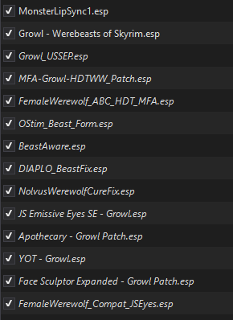

<div align="center">

# 🐺🌕 Proof of Concept: Werewolf Overhaul 🌕🐺

### *Female werewolves, fluffy fur, and beasts that talk back.*

**Female HDT werewolf body · fluffy fur shells · headless ABC male + MFA talking heads · SkyrimNet beast awareness**

`v0.1-poc` · Skyrim SE 1.5.97 · tested only on a modified Nolvus 6.0.21

</div>

---

> 🧪 **This is a Proof of Concept.** The files in this repository are **not finalized**. They are only known to work on my own modified **Nolvus 6.0.21** (Skyrim SE 1.5.97) system. Your mileage may vary, and the howling may be off-key.

> 🔞 Adult content (ABC). For adults 18+ only.

> 🔓 **Open source.** All the source code used to build it is in [`src/`](src/). If anyone wants to build on it and make a finalized version of anything here: **go for it.** But take note: **any finalized version that uses the female HDT body needs Duzellx's permission to use that body.** Otherwise, I recommend you seek out alternatives, such as [La Femme Lycana](https://www.nexusmods.com/skyrimspecialedition/mods/31049).

## 🩸 What it does

| Piece | What it does |
|---|---|
| **Female werewolf body** | Splits the werewolf body by sex, so Aela and other female werewolves no longer get ABC's male body. Females use the **HDT Werewolves** female body (2T) with **HDT-SMP breast and butt physics**. |
| **Fluffy fur** | Ten see-through fur "shell" layers on the male and female bodies, built the same way Fluffworks builds its werewolf fur. Males and females match. Fluffworks itself is not required. |
| **Headless ABC male + MFA talking heads** | ABC's male body with its built-in head, eyes and teeth unlinked, so the **Monster Lip Sync (MFA)** head is used. Beasts' mouths move when they talk through **SkyrimNet**. |
| **Growl/MFA race merges** | The werebear race keeps every Growl feature and gets MFA's head data. The werewolf race comes from HDT's MFA-and-Growl patch. |
| **JS Emissive Eyes compat** (`FemaleWerewolf_Compat_JSEyes.esp`) | JS Emissive Eyes' Growl patch otherwise wipes the MFA heads off the werewolf and werebear races. This patch keeps the glowing eyes **and** the talking heads. |
| **Beast Aware** (`BeastAware.esp` + SkyrimNet prompt) | SkyrimNet NPCs notice when you shift into or out of werewolf, werebear or Vampire Lord form, and see the beast in front of them. |

## ✅ What was tested

- ✔️ **Only Fluffy + 2T was tested.** It's what I use, with Fluffworks-style fur, because that is what Nolvus runs.
- ❌ The **other FOMOD options** (Smooth, Default, 6T) exist in [`src/fomod`](src/fomod) and the build scripts can generate them, but they are **untested**. They are **not** in the release.
- The release contains **only the versions of the files I have installed**, as a plain install with **no FOMOD**.

## 📋 Requirements

| Mod | Notes |
|---|---|
| Skyrim SE 1.5.97 + [SKSE64](https://skse.silverlock.org/) | |
| [SkyUI](https://www.nexusmods.com/skyrimspecialedition/mods/12604) | Beast Aware MCM |
| [FSMP - Faster HDT-SMP](https://www.nexusmods.com/skyrimspecialedition/mods/57339) | Female body physics |
| [Animated Beasts Cocks (ABC)](https://www.loverslab.com/files/file/7556-animated-beasts-cocksabc-for-users-le-se/) by BakaFactory | Male werewolf body (3.31 tested, with its **Furry Works** option) |
| [Growl - Werebeasts of Skyrim](https://www.nexusmods.com/skyrimspecialedition/mods/31245) | |
| [HDT Werewolves](https://www.nexusmods.com/skyrimspecialedition/mods/78295) | Main file **and** its **MFA and Growl Patch** file |
| [Monster Lip Sync (MFA)](https://www.nexusmods.com/skyrimspecialedition/mods/22878) | `MonsterLipSync1.esp` |
| [SkyrimNet](https://github.com/MinLL/SkyrimNet-GamePlugin) | Lip sync and Beast Aware |
| [JS Emissive Eyes SE](https://www.nexusmods.com/skyrimspecialedition/mods/60108) + its Growl patch | **Only if you use it.** It's required by the compat patch; if you don't use it, leave `FemaleWerewolf_Compat_JSEyes.esp` unticked. |

**Optional companion:** 🌕 [OStim Beast Form](https://github.com/Coronerra/OStim-Beast-Form).

**No Pandora or Nemesis run is needed.** Nothing here adds animations.

## 📦 Setup, step by step (MO2)

1. Install **ABC**, **Growl**, **Monster Lip Sync**, **HDT Werewolves** (main) and HDT Werewolves' **MFA and Growl Patch** as separate mods.
2. **Hide files** (right-click the mod → Information → Filetree → right-click → Hide):
   - **Monster Lip Sync:** `meshes\actors\werewolfbeast\character assets\body\malebodywerewolf.nif` (its male werewolf body).
   - **HDT MFA and Growl Patch:** `meshes\actors\werewolfbeast\character assets\malebodywerewolf_0.nif`, `_1.nif` (and `_2.nif` if present), so ABC's males aren't overwritten.
   - **HDT Werewolves main:** in the plugin list, **untick `Werewolves.esp`**. The MFA patch replaces it.
3. Download `Werewolf-Overhaul-PoC_v0.1.7z` from [Releases](../../releases) and install it in MO2 as one mod. It's a plain install, so the archive root is `Data`.
4. **Left pane (mod priority):** put this mod **below** (so it wins over) ABC, HDT Werewolves, HDT's MFA and Growl Patch, and Monster Lip Sync.
5. **Right pane (plugin order):** this is my tested order (other plugins in between are fine):
   ```
   MonsterLipSync1.esp
   Growl - Werebeasts of Skyrim.esp
   Growl_USSEP.esp
   MFA-Growl-HDTWW_Patch.esp
   FemaleWerewolf_ABC_HDT_MFA.esp
   OStim_Beast_Form.esp                    (optional companion)
   BeastAware.esp
   DIAPLO_BeastFix.esp                     (part of my Nolvus setup)
   NolvusWerewolfCureFix.esp               (part of my Nolvus setup)
   JS Emissive Eyes SE - Growl.esp         (if used)
   Apothecary - Growl Patch.esp            (part of my Nolvus setup)
   YOT - Growl.esp                         (part of my Nolvus setup)
   Face Sculptor Expanded - Growl Patch.esp (if used)
   FemaleWerewolf_Compat_JSEyes.esp        (last, only with JS Emissive Eyes)
   ```
   

6. Load a save. Give SkyUI a minute to register **Beast Aware** in the MCM. Then go howl at something. 🌕

## 🎥 Test videos

Recorded on the tested setup (Fluffy + 2T):

- 🐺 [Male werewolf test](docs/videos/male_werewolf_test.mp4)
- 🐺 [Female werewolf test](docs/videos/female_werewolf_test.mp4)

## ⚠️ Known caveats

- **Performance:** fur shells add about 28k triangles per male and about 115k per female werewolf, plus two uncompressed 5 MB textures.
- **Fur flicker:** layered alpha-tested shells can flicker or sort oddly from some angles.
- **Breast poke-through:** with SMP physics, the outer fur layers can clip at the breasts.
- **Neck seam:** body fur stops at the neck; the MFA head isn't furred, because shells can't follow its lip-sync morphs. The ABC body and MFA head weren't made together, so a seam can show.
- **Lip sync:** BFA declines the beast heads, so SkyrimNet's fallback lip sync drives their mouths.
- **Tested setup:** only on my modified Nolvus 6.0.21 build.

## 🛠️ Building from source

See [`src/README.md`](src/README.md). The Python scripts regenerate every FOMOD option, the plugins, the fur shells and the textures from your own copies of the required mods. Beast Aware's Papyrus sources are in `src/beastaware` and `Data/Scripts/Source`.

## 🙏 Credits

- **Duzellx**, **jacques00**, **Allegretto**, **purenexus**: HDT Werewolves and its female body and patches
- **BakaFactory**: Animated Beasts Cocks
- **Enai Siaion**: Growl - Werebeasts of Skyrim
- The **Monster Lip Sync (MFA)** authors
- The **Fluffworks** author: the fur-shell technique and pattern
- **johnskyrim**: JS Emissive Eyes
- The **SkyrimNet** team
- 💜 **Lirael**, whose OCreatures work powers the companion OStim Beast Form: [Lirael on Patreon](https://www.patreon.com/LiraelAtelier)
- **That Guy (Coronerra)**: this proof of concept

## 📜 License

My code is [MIT](LICENSE) © coronerra. **Third-party assets** (the edited HDT Werewolves female meshes, the edited ABC male meshes and the Fluffworks-derived fur textures) are **not** covered and belong to their authors. See [LICENSE](LICENSE).

---

*I truly hope someone picks this project up as it would be great for the world to use in their own builds, but I am stopping here as this works on my system. Have fun and Happy Modding!* 🐺
